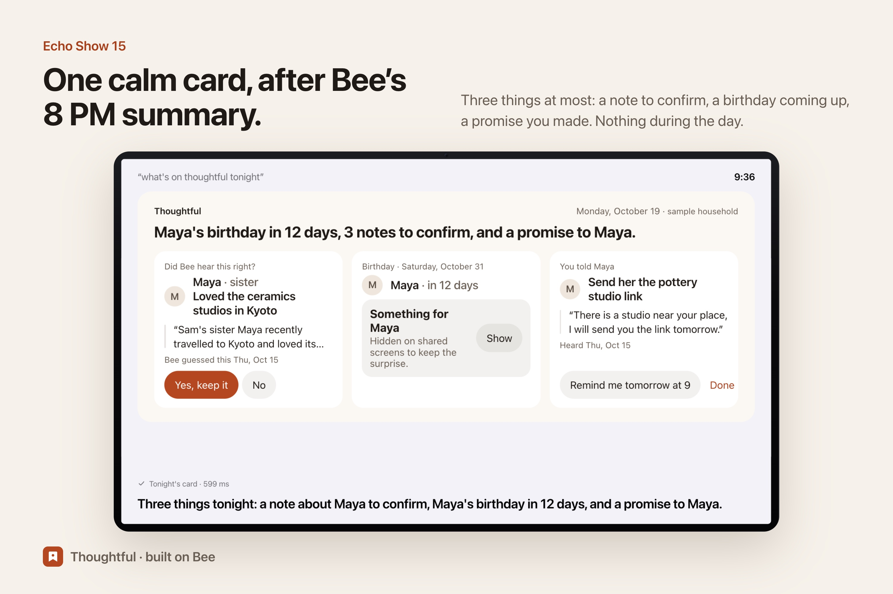

# Thoughtful

[](https://github.com/blanco1er/thoughtful/actions/workflows/test.yml)  

**Bee hears what the people you love care about. Thoughtful keeps it, quietly, and gives it back at the right moment, without ever interrupting a conversation.**

Your sister said she has been dying to try a pottery wheel. Your best friend ran his first half-marathon on Sunday. You promised your grandmother the garden photo album. You will forget two of the three. Thoughtful will not, and it will never speak up while you are with them.

- **During the day:** nothing. Bee listens; Thoughtful reads Bee in the background.
- **In the evening,** right after Bee's 8 PM summary: one calm card, on an Echo Show or on your iPhone, with **three things at most**: one note to confirm ("Did Bee hear this right?"), one occasion coming up (her own words, with dates, three real gift ideas and a real place nearby), one promise to keep.
- **The next day,** only what you kept reaches your wrist, as a Bee to-do with an alarm, at a quiet moment: before you see someone, never during a conversation, never more than twice a day.



Built for the Bee (Wearable AI) track of the Amazon Developer hackathon "Build, Ship, Shape" (2026).

---

## Try it in 2 minutes (no Bee account, no AWS)

```sh
git clone <this repo> && cd thoughtful
npm install
npm run sample          # sample household: INVENTED people and conversations
open http://127.0.0.1:4317
```

The sample household plays the exact same product on invented data: five conversations (a dinner with a sister back from Kyoto, a call with a friend before his first half-marathon, a visit to a grandmother, a TV show playing in the living room, a coffee with a colleague). Its notes were extracted once by Amazon Bedrock and are replayed, with dates moved to today, so it works offline. Its gift ideas are a dated snapshot of real Channel3 results; its place is an OpenStreetMap result (or live Google Places details if you set a key). The TV show, a knee surgery and a mention of church are set aside, as they would be on real data.

**Other MCP clients and an Agent Skill:** see [docs/mcp.md](docs/mcp.md) and [skill/thoughtful/SKILL.md](skill/thoughtful/SKILL.md).

**On an Echo Show (MCP Apps):** Thoughtful is also an MCP server. Open it in [mcp-voice-host](https://github.com/blanco1er/mcp-voice-host), our open-source Alexa+-style host:

```sh
npx github:blanco1er/mcp-voice-host --server http://127.0.0.1:4317/mcp
# say or type: "what's on thoughtful tonight"
```

## Use it with your own Bee

1. Developer Mode in the Bee app (Settings, tap the app version 5 times), then on your Mac: `npx bee login` (from this folder).
2. Bedrock access (Amazon Nova 2 Lite in us-east-1) with a named AWS profile, saved once: `node bin/thoughtful.mjs config aws-profile <profile>` (the author uses `mandat`). `THOUGHTFUL_AWS_PROFILE` or `AWS_PROFILE` override it. Settings and `doctor` say whether credentials are found.
3. Optional, for real gift ideas and places: `scripts/set-channel3-local.sh` and `scripts/set-places-local.sh` (keys go to the macOS Keychain, never to a file).
4. `npm start`, open http://127.0.0.1:4317, read the three promises, tick the consent line, "Use my Bee".
5. On your iPhone (same Wi-Fi or Tailscale): `node bin/thoughtful.mjs serve --host 0.0.0.0` prints a one-time pairing link.

`node bin/thoughtful.mjs doctor` checks the Bee CLI, the AWS credentials and the keys (yes/no only). `node bin/thoughtful.mjs sync --reprocess-last 1` (or Settings > "Read the last conversation again") reads the latest conversation again, printing counts only.

Long conversations (a family dinner can be 60 000+ characters) are read in windows of about 20 000 characters that overlap by 1 500, cut between sentences (8 windows at most per conversation); the notes of all windows are merged, each quote checked in its own window.

## How it uses Bee

Everything goes through the official Bee CLI library, imported in [`src/bee.mjs`](src/bee.mjs) (`import { createBeeClient } from '@beeai/cli/lib'`), which runs the signed `bee` binary with `--json`.

| Bee capability | Call | What Thoughtful does with it |
|---|---|---|
| Conversations + transcripts | `conversations.list`, `conversations.get` | Reads finished conversations (final transcription preferred, Bee duplicates removed). |
| Speaker identification | `utterances[].speaker` | A promise counts only if **you** said it. A conversation you were not part of (TV, people nearby) is skipped. |
| Real-time stream | `sse.streamJson` (`new-utterance`, conversation events), with our own reconnection | Knows when someone is talking, so a reminder waits for silence. Triggers a read when a conversation ends. |
| Pending facts | `facts.list --unconfirmed` | Bee's own guesses about people close to you are offered for one-tap confirmation. |
| Fact writes | `facts.create`, `facts.confirm`, `facts.delete` | A note you keep becomes a **confirmed Bee fact** ("Maya (sister) would love: a pottery wheel class. Heard by Bee on …"), so every agent that reads Bee (Alexa+ included) knows it. "Forget" deletes it. |
| To-do writes with alarm | `todos.create --alarm-at` | The only way Thoughtful reaches your phone and watch: one line, one minute ahead, at a quiet moment. |
| Today brief | `today` (calendar) | "Before you see someone": an event with a known person plans one reminder 30 minutes before. |

## Never annoying (rules in code, each with a test)

1. Nothing during a conversation: a reminder is postponed while Bee hears speech in the last 20 minutes or a conversation is being captured.
2. At most 3 things on the evening card, at most 3 confirmations a day, at most 2 reminders a day.
3. Nothing is used before you say yes. Every note shows the words it comes from and their date. A quote the model cannot ground in the transcript is dropped.
4. Never kept: health, conflicts, breakups, politics, religion, other people's money. Never kept: what sounds like TV, radio or a video.
5. Surprises stay surprises: on a shared screen (Echo Show), the gift part is covered until you tap "Show", and covered again after 10 minutes. The voice never reads a gift aloud.
6. No ads, no purchase. Gift ideas link to the merchant; Thoughtful never buys.
7. Memories expire: plans after their date, unconfirmed notes after a few months.

## Privacy

- Your notebook is a local file (`~/Library/Application Support/Thoughtful`, mode 600). It keeps short notes, the few words that prove them, and dates. Never full transcripts, never audio.
- Sentences about health, conflicts, politics, religion or money are removed **on your Mac** before a transcript is sent for extraction.
- The only data that leaves your Mac: the conversation being read, sent to Amazon Bedrock (your own AWS account) for extraction; a gift search phrase to Channel3; an activity and your neighbourhood (never an address) to Google Places.
- Third-party data: from Google Places only the **place ID** is ever stored (Google Maps Platform terms); name, address and rating are fetched live, kept in memory for an hour, and shown with the "Google Maps" attribution. Without a Google key, places come from OpenStreetMap (Nominatim, © OpenStreetMap contributors). Gift ideas are filtered to a gift price range (15 to 250 USD, `THOUGHTFUL_GIFT_PRICE_MIN/MAX`).
- Settings > "Erase everything" deletes the notebook and the facts Thoughtful wrote to Bee.
- No real data in this repository: tests use invented fixtures; `npm run check` refuses secrets, runtime files and the owner's last name.

## Architecture

```
Bee (Apple Watch / wearable)
   │  conversations, speaker ids, pending facts, calendar     ┌──────────── Amazon Bedrock (Nova 2 Lite)
   ▼                                                          │  one call per finished conversation,
@beeai/cli/lib ── src/bee.mjs ── src/engine.mjs ──────────────┘  spending cap in code (1 $/day, 5 $ total)
                                     │ guards (src/extract/filters.mjs): sensitive, media, grounded quote, owner promise
                                     ▼
                     private notebook (src/store.mjs, local JSON)
                    ┌────────────────┼──────────────────────┐
           web app (web/)     MCP server (src/mcp.mjs)    nudges (src/nudges.mjs)
           iPhone, EN/FR      Streamable HTTP 2025-11-25   Bee todo + alarm → phone & watch
                              MCP Apps card on Echo Show
                              Channel3 gifts · Google Places
```

## Tests

```sh
npm test        # 50 tests, invented fixtures only, no network
AWS_PROFILE=<profile> node scripts/bench-extraction.mjs 3   # quality on 10 invented FR/EN conversations (≈ 1 cent)
npm run check   # tests + private data check
```

Last measured with Amazon Nova 2 Lite (19 Oct 2026): **79 to 93 % recall depending on the run, 0 leaks in every run** (health, conflicts, votes, debts, TV, jokes, other people's promises), 2 to 9 extra notes out of about 45.

```sh
```

The tests drive the real `@beeai/cli/lib` against a stand-in `bee` binary to check the exact commands sent (`todos create --alarm-at`, `facts confirm`, …).

## Built with

Bee CLI library (`@beeai/cli` 0.8.0) · Amazon Bedrock (Nova 2 Lite, Converse API) · Model Context Protocol SDK 1.32.1 with MCP Apps · Channel3 product search · Google Places API (New) · Node.js 22, no front-end framework.

## License

MIT. See [LICENSE](LICENSE).
